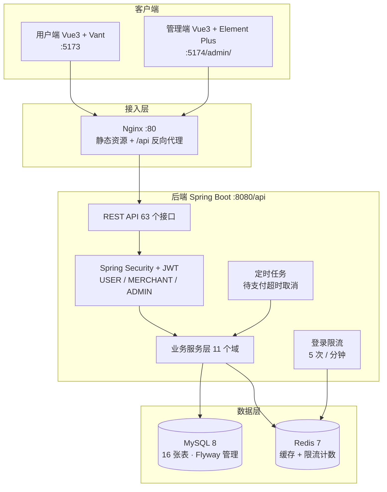

# 酒店预订管理系统

> 基于 Spring Boot 4 + Vue 3 的三端酒店预订平台：用户端下单、商家端经营、平台端治理，覆盖「搜索 → 预订 → 支付 → 审核 → 入住 → 评价 / 退订」完整业务闭环。

---

## 一、项目描述

### 背景与目标

对标同程旅行酒店模块，把一套真实的酒店预订业务拆成**三条角色链路**，在一个工程内实现并跑通：

| 角色       | 入口                | 核心诉求                                     |
|------------|---------------------|----------------------------------------------|
| 普通用户   | 用户端（移动端 H5） | 快速找到合适酒店、顺畅下单、订单可管可退     |
| 商家       | 商家端（管理后台）  | 维护酒店房型库存、处理订单与退订、回复评价   |
| 平台管理员 | 平台管理端          | 审核商家入驻、监管全平台订单与用户、运营内容 |

### 业务闭环

```
用户搜索（省/市 + 日期 + 关键词）
   → 酒店列表 / 详情 / 房型
   → 选择房型与入住人 → 库存预扣 → 生成订单（待支付）
   → 模拟支付 → 已支付
   → 商家审核入住人 → 已确认
   → 办理入住 → 完成 → 评价（商家可回复）
              ↘ 提前退订申请 → 商家审核 → 退款
              ↘ 待支付超时 30 分钟自动取消并释放库存
```

### 项目规模

| 指标           | 数量                                                                              |
|----------------|-----------------------------------------------------------------------------------|
| 后端 REST 接口 | **63 个**（21 个 Controller）                                                     |
| 业务模块       | **11 个**（认证、酒店、库存、订单、评价、收藏、优惠券、Banner、看板、审计、用户） |
| 数据库表       | **16 张**（14 个 Flyway 版本脚本）                                                |
| 前端页面       | 用户端 **12 页** + 管理端 **13 页**                                               |
| 自动化测试     | **31 个**（单元 + MockMvc 集成），全部通过                                        |

---

## 二、项目技术栈

### 后端

| 类别   | 技术                                            | 版本           | 用途                                            |
|--------|-------------------------------------------------|----------------|-------------------------------------------------|
| 框架   | Spring Boot                                     | 4.1.0          | 应用底座（Spring Framework 7）                  |
| 语言   | Java                                            | 17             | 编译目标（`java.version=17`，JDK 17+ 均可运行） |
| Web    | Spring MVC + Validation                         | —              | REST 接口与参数校验                             |
| 安全   | Spring Security + JJWT                          | 0.12.6         | 无状态 JWT 鉴权、角色控制                       |
| ORM    | MyBatis-Plus                                    | 3.5.9          | 单表 CRUD、逻辑删除、分页                       |
| 数据库 | MySQL                                           | 8.0            | 主数据存储                                      |
| 迁移   | Flyway                                          | 12.4.0         | 版本化建表与种子数据                            |
| 缓存   | Redis + Spring Data Redis                       | 7 / Lettuce    | Banner/城市缓存、登录限流                       |
| 文档   | springdoc-openapi（Swagger UI）                 | 2.8.4          | 在线接口文档 + JWT 调试                         |
| 测试   | JUnit 5 + MockMvc + H2                          | —              | 单元测试与接口集成测试                          |
| 规范   | Spotless（google-java-format AOSP）+ Checkstyle | 2.43.0 / 3.6.0 | 格式化与静态检查                                |

### 前端

| 端        | 技术                                           | 版本                        |
|-----------|------------------------------------------------|-----------------------------|
| 两端通用  | Vue 3 · Vite · TypeScript · Pinia · Vue Router | 3.5 / 6.4 / 5.7 / 2.3 / 4.5 |
| 用户端 UI | Vant                                           | 4.9                         |
| 管理端 UI | Element Plus                                   | 2.9                         |

### 工程化与部署

| 类别 | 技术                    | 说明                               |
|------|-------------------------|------------------------------------|
| 容器 | Docker + Docker Compose | MySQL / Redis / App / Nginx 四服务 |
| 网关 | Nginx 1.27              | 静态资源 + `/api` 反向代理         |
| CI   | GitHub Actions          | 代码风格 → 静态检查 → 测试 → 打包  |

### 选型说明

- **单体而非微服务**：业务边界清晰但团队规模小，单体 + 按域分包（每个域自带 `controller/dto/entity/mapper/service`）能获得同等的可维护性，还免去了分布式事务与运维成本。
- **MyBatis-Plus 而非 JPA**：本项目有大量按日期区间查库存、按状态聚合看板的场景，手写 SQL 更直观。
- **Flyway 而非手工导 SQL**：建表、索引、演示数据都进版本库，新环境启动即自动初始化，避免"我这能跑"。

---

## 三、项目架构

### 部署架构



开发态不经过 Nginx：Vite dev server 把 `/api` 代理到 `localhost:8080`，所以前端代码里统一写相对路径 `/api/xxx`，生产与开发无需改代码。

### 后端分层

```
Controller（参数校验 / 权限注解 / 统一返回）
    ↓
Service（业务规则、事务边界、状态机校验）
    ↓
Mapper（MyBatis-Plus）
    ↓
MySQL / Redis
```

横切能力集中在 `common` 与 `config` 包：

| 组件                           | 作用                                        |
|--------------------------------|---------------------------------------------|
| `common/result`                | 统一返回体 `{code, message, data}`          |
| `common/exception` + `handler` | 全局异常处理，业务异常与系统异常分开        |
| `common/filter`                | 请求日志 + `traceId` 透传，便于串联一次请求 |
| `common/cache`                 | Banner / 城市列表缓存封装，写操作自动失效   |
| `common/util`                  | 手机号脱敏等工具                            |
| `auth/security`                | JWT 过滤器、用户上下文、方法级角色校验      |

### 目录结构

```
hotel-reservation-system/
├── src/main/java/daydream/hotel/reservation/system/
│   ├── auth/            认证、JWT、登录限流
│   ├── user/            用户资料、改密、管理端用户管理
│   ├── hotel/           酒店、房型、设施、入驻审核
│   ├── inventory/       库存日历、预扣与释放、补库
│   ├── order/           下单、支付、取消、退订、状态机
│   ├── review/          评价与商家回复
│   ├── favorite/        收藏
│   ├── coupon/          优惠券、领券、抵扣
│   ├── banner/          首页轮播（带缓存）
│   ├── dashboard/       商家经营看板 / 平台仪表盘
│   ├── audit/           操作审计日志
│   ├── common/          统一返回、异常、缓存、过滤器、工具
│   └── config/          Security、MyBatis-Plus、Swagger 等配置
├── src/main/resources/
│   ├── db/migration/    V1~V14 Flyway 脚本
│   ├── data/china/      省市级联数据
│   └── application*.yml dev / docker / prod 多环境配置
├── src/test/            单元测试 + MockMvc 集成测试
├── user-web/            用户端（Vant）
├── admin-web/           管理端（Element Plus）
├── docker/nginx.conf    Nginx 配置
├── docker-compose.yml   全栈一键启动
├── docker-compose.dev.yml  仅中间件（本地开发）
└── .github/workflows/ci.yml
```

### 关键技术设计

| 设计点         | 做法                                                                                                                                          |
|----------------|-----------------------------------------------------------------------------------------------------------------------------------------------|
| **鉴权**       | 登录签发 JWT，前端存本地并随 `Authorization: Bearer` 发送；后端无会话状态，按 `role` 做接口级隔离；商家与管理员共用管理端，菜单按角色动态渲染 |
| **库存防超卖** | 库存按「房型 × 日期」存 `inventory_calendar`；下单预扣、取消/拒审/超时释放，释放逻辑幂等，避免重复回补                                        |
| **订单状态机** | 9 个状态（待支付/已支付/已确认/已入住/退订中/已完成/已取消/退款中/已退款），状态流转集中在一个枚举类里校验，禁止非法跳转                      |
| **缓存**       | Banner 600s、城市列表 1800s；管理端修改后主动删 key，避免脏读                                                                                 |
| **限流**       | 登录按 `IP + 手机号` 计数，5 次/分钟，超限直接拒绝，防止撞库                                                                                  |
| **定时任务**   | 每分钟扫描超时未支付订单（默认 30 分钟），自动取消并释放库存与优惠券                                                                          |
| **审计**       | 管理端敏感操作落 `sys_audit_log`，可追溯谁在何时改了什么                                                                                      |

---

## 四、项目功能

### 用户端（12 页）

| 模块     | 功能                                                                 |
|----------|----------------------------------------------------------------------|
| 首页     | 省/市级联选择、入住离店日期、关键词搜索、Banner 轮播、热门酒店       |
| 酒店列表 | 分页、星级筛选、价格排序、关键词过滤                                 |
| 酒店详情 | 图片、设施、房型与价格、评价列表、收藏                               |
| 预订     | 入住人信息、房间数、优惠券抵扣、库存预扣、订单确认                   |
| 支付     | 模拟支付，支付后进入商家审核流程                                     |
| 订单中心 | 按状态筛选、订单详情、取消（仅待支付）、提前退订申请、删除已完成订单 |
| 评价     | 入住完成后评分 + 文字评价，查看商家回复                              |
| 优惠券   | 领券、我的券、下单可用券展示                                         |
| 收藏     | 收藏/取消收藏、收藏列表                                              |
| 个人中心 | 资料查看与修改、改密、退出登录                                       |

### 商家端（管理后台，按角色显示菜单）

| 模块     | 功能                                        |
|----------|---------------------------------------------|
| 经营看板 | 订单量、成交额、待处理事项汇总              |
| 我的酒店 | 创建/编辑酒店与房型、提交平台审核           |
| 库存日历 | 按日期维护房量与价格、批量补库              |
| 订单处理 | 审核入住人信息、办理入住/完成、处理提前退订 |
| 评价管理 | 查看本店评价、回复评价                      |

### 平台管理端

| 模块     | 功能                                 |
|----------|--------------------------------------|
| 仪表盘   | 平台整体订单、用户、酒店、成交额统计 |
| 入驻审核 | 审核商家提交的酒店，通过/驳回        |
| 订单管理 | 全平台订单查询与状态查看             |
| 用户管理 | 用户列表、启用/禁用                  |
| 评价治理 | 全平台评价展示控制                   |
| 运营内容 | Banner 增删改查、优惠券发放与管理    |
| 操作日志 | 管理端操作审计记录查询               |

### 接口分布

| 模块                         | 接口数    | 模块                  | 接口数    |
|------------------------------|-----------|-----------------------|-----------|
| 商家-酒店/房型/库存          | 10        | 订单（用户）          | 8         |
| 酒店（查询）                 | 5         | 商家-订单             | 5         |
| 收藏                         | 4         | Banner（用户/管理端） | 1 + 4     |
| 优惠券 / 管理端优惠券        | 3 + 3     | 用户（资料/管理）     | 3 + 2     |
| 评价 / 商家回复 / 管理端评价 | 2 + 2 + 2 | 认证 / 健康检查       | 2 + 1     |
| 看板（平台/商家）            | 1 + 1     | 管理端-酒店/订单/日志 | 2 + 1 + 1 |

---

## 五、项目实现结果

### 功能完成度

- 三端全部可用：用户端 12 个页面、管理端 13 个页面，菜单按角色区分，无「假页面」；
- 业务主链路完整跑通：**搜索 → 详情 → 下单 → 支付 → 商家审核 → 入住 → 评价**，以及两条逆向链路 **取消**（待支付）和 **提前退订**（已确认后申请 + 商家审核退款）；
- 库存一致性：预扣/释放覆盖「下单、取消、拒审、超时」四种出口，重复释放有幂等保护；
- 数据初始化无手工步骤：启动即由 Flyway 建 16 张表并灌入省份城市、演示酒店、房型、库存、优惠券、Banner。

### 量化结果

| 维度 | 结果                                                                                                 |
|------|------------------------------------------------------------------------------------------------------|
| 接口 | 63 个 REST 接口，统一 `{code,message,data}` 返回，Swagger 全覆盖                                     |
| 数据 | 16 张表 / 14 个迁移版本，逻辑删除 + 审计字段统一                                                     |
| 测试 | 31 个测试用例 **0 失败 0 错误**（订单创建、库存扣减/释放、退款计算、脱敏、认证、酒店搜索、订单流程） |
| 规范 | Spotless 格式化 + Checkstyle 静态检查，`mvn verify` 全绿                                             |
| CI   | GitHub Actions 四步：风格检查 → 静态检查 → 测试 → 打包                                               |
| 部署 | Docker Compose 一条命令拉起 MySQL + Redis + App + Nginx，浏览器即可访问双端                          |

### 可验证的成果

```bash
./mvnw test          # 31 个测试
./mvnw verify        # 规范 + 测试 + 打包
docker compose up -d --build   # 全栈部署
```

| 入口   | 地址                                                          |
|--------|---------------------------------------------------------------|
| 用户端 | http://localhost/ （Docker） / http://localhost:5173 （开发） |
| 管理端 | http://localhost/admin/ / http://localhost:5174/admin/        |
| API    | http://localhost/api/health                                   |
| 文档   | http://localhost/api/swagger-ui.html                          |

### 工程细节

- **统一异常**：业务异常带明确错误码，系统异常兜底不泄露堆栈，前端只需处理 `code`；
- **链路追踪**：每个请求带 `traceId`，日志与响应可对齐；
- **隐私**：接口返回的手机号中间四位脱敏为 `****`；
- **可观测**：`/api/health` 健康检查，Docker healthcheck 依赖它判断就绪。

### 已知限制

| 限制       | 说明                                                 |
|------------|------------------------------------------------------|
| 支付为模拟 | 未接入真实支付渠道，`/pay` 直接置为已支付            |
| 单机部署   | 未引入消息队列与分布式锁，库存并发控制依赖数据库事务 |
| 无文件上传 | 酒店图片使用外链 URL，未做对象存储                   |
| 无实时通知 | 订单状态变更通过前端轮询/刷新获取                    |

---

## 附一：快速开始

### 方式 A：Docker 全栈

```bash
# 先构建前端静态资源
cd user-web  && npm install && npm run build && cd ..
cd admin-web && npm install && npm run build && cd ..

docker compose up -d --build
```

### 方式 B：本地开发（推荐，便于调试）

```bash
# 1. 只起中间件（MySQL → 宿主 3308，Redis → 宿主 6379）
docker compose -f docker-compose.dev.yml up -d

# 2. 起后端（IDEA 里直接运行主类也可以）
./mvnw spring-boot:run

# 3. 起前端
cd user-web  && npm install && npm run dev   # http://localhost:5173
cd admin-web && npm install && npm run dev   # http://localhost:5174/admin/
```

后端地址 `http://localhost:8080/api`（`server.servlet.context-path: /api`）。

### 环境变量

默认值写在 `application-dev.yml`，可用环境变量覆盖：

| 变量                              | 默认                        | 说明                                     |
|-----------------------------------|-----------------------------|------------------------------------------|
| `DB_HOST` / `DB_PORT` / `DB_NAME` | localhost / 3308 / hotel_db | Docker 映射到 3308，避免与本机 3306 冲突 |
| `DB_USER` / `DB_PASSWORD`         | root / root                 |                                          |
| `REDIS_HOST` / `REDIS_PORT`       | localhost / 6379            |                                          |
| `JWT_SECRET` / `JWT_EXPIRATION`   | 内置开发密钥 / 86400000     | 生产必须替换                             |

> **注意**：Spring Boot 不读取根目录的 `.env`，那个文件只对 `docker compose` 有意义。要让后端换库，请改 `application-dev.yml` 默认值或在运行配置里设环境变量。

---

## 附二：演示账号

| 端             | 账号                                     | 密码        | 角色     |
|----------------|------------------------------------------|-------------|----------|
| 管理端（平台） | 13800000000                              | admin123    | ADMIN    |
| 管理端（商家） | 13800100001 ~ 13800100010                | merchant123 | MERCHANT |
| 用户端         | 自行注册，或调 `POST /api/auth/register` | —           | USER     |

> 接口返回的手机号已脱敏（`138****0000`）。「使用我的信息」填入住人手机号时需使用登录时的完整号码。

---

## 附三：常见问题

| 现象                                   | 原因与处理                                                                                                                      |
|----------------------------------------|---------------------------------------------------------------------------------------------------------------------------------|
| 启动报 `Access denied for user 'root'` | 端口被本机其他 MySQL 占用，连到了别的实例。先 `docker ps` 确认 3308 是 `hotel-mysql`，再检查本机是否有 MySQL 服务绑定了同一端口 |
| 管理端白屏                             | 地址缺尾部斜杠，必须访问 `/admin/`                                                                                              |
| 前后端跨域                             | 开发态由 Vite 代理 `/api` 到 8080，无需配置 CORS；若改端口需同步 `vite.config.ts` 的 `proxy.target`                             |
| 8080 端口占用                          | 只能同时跑一个后端实例，先停掉旧进程                                                                                            |
| 数据想重置                             | `docker compose -f docker-compose.dev.yml down -v` 删卷后重启，Flyway 会重新初始化                                              |
